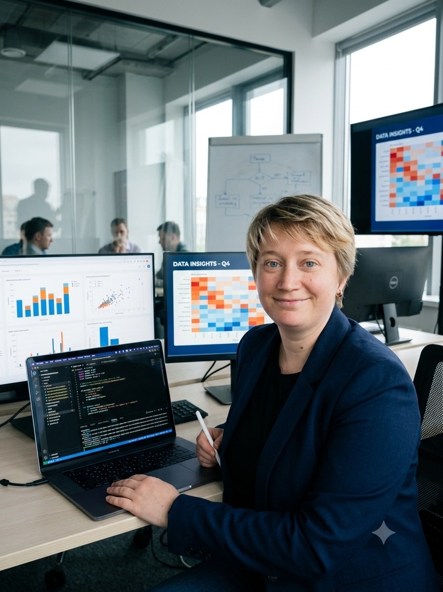

# Привет! Я Оксана Петрова 👋

Добро пожаловать в мое портфолио аналитика данных.

Я аналитик данных с 10-летним опытом работы с данными и процессами в крупных компаниях (логистика, финансы, управление). Сейчас я системно развиваюсь в аналитике данных, пройдя обучение в Яндекс.Практикуме, и активно применяю новые навыки на практике. Мой подход — не просто видеть цифры, а понимать бизнес-задачи, которые за ними стоят.

## 🛠️ Ключевые навыки

| Область | Инструменты |
| :--- | :--- |
| **Языки и БД** | Python (Pandas, NumPy, Matplotlib, SciPy, Seaborn, Plotly, SQLAlchemy), SQL (PostgreSQL), API (REST, WebSocket) |
| **BI и визуализация** | Power BI, Yandex DataLens, Power Query, Power Pivot, Excel (эксперт) |
| **Анализ данных** | A/B-тестирование, статистический анализ, предобработка данных, декомпозиция метрик, когортный анализ |
| **Машинное обучение** | Scikit-learn (Random Forest, SMOTE) |
| **Автоматизация и AI** | Разработка торговых и Telegram-ботов, интеграция с AI (DeepSeek), работа с API бирж, Telegram Bot API (pyTelegramBotAPI), SQLite, python-dotenv, асинхронное программирование |
| **Другое** | Jupyter Notebook, Folium, 1С, Oracle HR, управление проектами |

## 📁 Проекты

| Название проекта | Описание | Стек | Ссылка |
| :--- | :--- | :--- | :--- |
| 🤖 Crypto Trading Bot | Мульти-аккаунтный торговый бот для криптовалют, объединяющий технический анализ, машинное обучение и AI-верификацию (DeepSeek). Результат на демо-счете: винрейт 67.8%, Profit Factor 2.15. | Python, Bybit API, Scikit-learn, DeepSeek API, Pandas, asyncio | crypto_trading_bot |
| 🤖 Telegram-бот для записи на услуги | Демонстрационный бот с меню, кнопками и сохранением данных в SQLite. Уведомления администратора. | Python, pyTelegramBotAPI, SQLite, python-dotenv | booking-telegram-bot |
| Анализ надежности заемщиков банка | Анализ влияния семейного положения, дохода и других факторов на возврат кредита. Предобработка данных, категоризация признаков. | Python (Pandas, NumPy) | borrower_reliability_analysis |
| Исследование объявлений о продаже квартир | Анализ рынка недвижимости Санкт-Петербурга и области: выявление факторов, влияющих на стоимость, определение аномалий. | Python (Pandas, Matplotlib) | apartment_listings_analysis |
| Статистический анализ данных сервиса аренды самокатов GoFast | Анализ поведения пользователей, проверка гипотез о влиянии подписки на расстояние поездок и выручку. | Python (Pandas, SciPy) | gofast_scooter_analysis |
| Анализ рынка компьютерных игр | Исследование исторических данных о продажах игр, выявление закономерностей, определение прибыльных платформ и жанров. | Python (Pandas, Matplotlib, Seaborn) | games_market_analysis |
| Анализ бизнес-показателей приложения Procrastinate Pro+ | Маркетинговый анализ: расчет LTV, CAC, ROI, когортный анализ, выявление причин убытков. | Python (Pandas, Matplotlib, Seaborn) | procrastinate_pro_analysis |
| Анализ результатов A/B-теста для интернет-магазина | Оценка корректности проведения A/B-теста, проверка гипотез о различиях в поведении пользователей. | Python (Pandas, NumPy, Matplotlib, SciPy) | ab_test_online_store |
| Анализ поведения пользователей мобильного приложения | Анализ воронки продаж, исследование результатов A/A/B-теста по смене шрифтов. | Python (Pandas, Matplotlib, Seaborn, SciPy) | mobile_app_funnel_analysis |
| Анализ рынка заведений общественного питания Москвы | Исследование рынка общепита: структура заведений по районам, адреса, сетевые и несетевые заведения. Визуализация на карте города. | Python (Pandas, Matplotlib, Seaborn, Plotly, Folium) | moscow_restaurants_market |
| Анализ поведения пользователей мобильного приложения "Ненужные вещи" | Анализ поведения пользователей, воронка продаж, исследование результатов A/B-теста. | Python (Pandas, Matplotlib, Seaborn, SciPy, Plotly) | unnecessary_things_app |
| Анализ книжной базы данных | Анализ книжной базы данных с помощью SQL и Python. Написание сложных запросов, объединение таблиц, агрегация данных. | Python (Pandas, SQLAlchemy), PostgreSQL | books_database_analysis |

*Проекты 1–10 выполнены в рамках обучения в Яндекс.Практикуме. Crypto Trading Bot и Telegram-бот для записи на услуги — самостоятельные разработки.*

## 📄 Документы

| Документ | Скачать PDF |
| :--- | :--- |
| Резюме | Петрова_Оксана_Резюме.pdf |
| Сопроводительное письмо (шаблон) | Сопроводительное_письмо_Петрова_О.pdf |

## 🎓 Образование и курсы

| Год | Учебное заведение / Курс | Специализация |
| :--- | :--- | :--- |
| 2025 | Яндекс.Практикум | Аналитик данных |
| 2013 | Московский Открытый Институт | Управление проектами |
| 2022 | Нетология | Аналитика данных |
| 2022 | SoloLearn | SQL |
| 2020 | МГТУ им. Н.Э. Баумана | Продвинутый Excel |

## 🤖 О подходе к работе

Я верю, что хороший аналитик — это не только знание инструментов, но и умение быстро находить информацию, проверять гипотезы и выстраивать эффективную коммуникацию.

В процессе подготовки портфолио я активно использую:

- **Git и GitHub** — для контроля версий и структурирования проектов
- **Jupyter Notebook** — для чистого, воспроизводимого кода с выводами
- **ИИ-ассистентов** — для ускорения рутинных задач, оптимизации запросов и структурирования документации

Такой подход помогает мне сосредотачиваться на главном — извлечении инсайтов из данных и принятии обоснованных решений.

## 📫 Контакты

| Канал | Ссылка |
| :--- | :--- |
| Email | oxykbuff11@yandex.ru |
| Телефон | +7 (903) 222-33-24 |
| Telegram | @capoeira_chika |
| GitHub | oksana-analytics |

---

*Это живой проект, и я постоянно работаю над его улучшением. Спасибо, что заглянули!*
